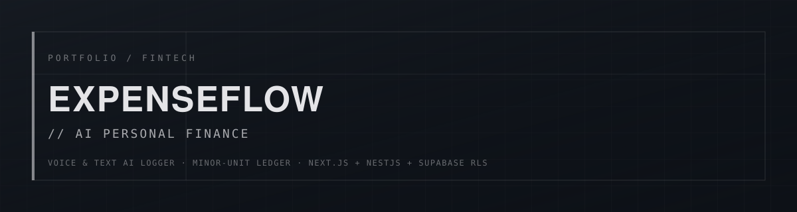
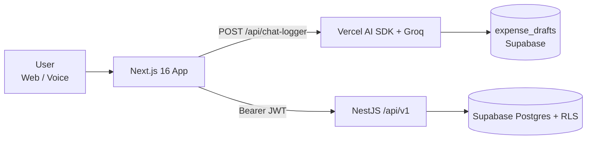

<div align="center">



<br />

**Natural-language expense logging with a minor-unit ledger, JWT-guarded Nest API, and Supabase RLS.**

<br />

<a href="https://expense-tracker-tjv1-amber.vercel.app/">
  
</a>
&nbsp;
<a href="https://github.com/smibrahimali">
  
</a>

</div>

---

## System Architecture



---

## Core Engineering Highlights

<table>
  <tr>
    <td width="50%" valign="top">
      <h3>AI Quick Logger &amp; Voice</h3>
      <p>Natural-language create / edit / delete via Groq. Multi-turn sessions persist in <code>expense_drafts</code>. Browser speech-to-text feeds the same chat pipeline.</p>
    </td>
    <td width="50%" valign="top">
      <h3>Financial Precision</h3>
      <p>Amounts stored as <code>amount_minor</code> (bigint) — no floating-point drift. Dashboard covers 6-month trends and flags expenses above 30% of salary.</p>
    </td>
  </tr>
  <tr>
    <td width="50%" valign="top">
      <h3>Auth &amp; Multi-Layer Security</h3>
      <p>Chat routes derive user IDs from the Supabase session cookie. NestJS validates Bearer JWTs; Postgres RLS isolates direct client access.</p>
    </td>
    <td width="50%" valign="top">
      <h3>Monorepo &amp; Schema Design</h3>
      <p>Decoupled Next.js + NestJS apps. Ordered SQL migrations <code>001</code>–<code>003</code>. Category rename syncs matching expense <code>category_id</code> name rows.</p>
    </td>
  </tr>
</table>

---

## Tech Stack

<div align="center">


</div>

---

<details>
<summary><b>Project Structure &amp; Database Migrations</b></summary>

<br />

```text
expense-tracker/
├── apps/
│   ├── web/                 # Next.js UI + /api/chat-logger
│   └── api/                 # NestJS /api/v1 expenses + reports
├── supabase/migrations/     # Schema, RLS, seeds, upgrades
└── README.md
```

**Core tables:** `profiles`, `monthly_salaries`, `categories`, `expenses`, `expense_drafts`.

**Design note:** `expenses.category_id` stores the **category name** (text), not a UUID. The `categories` table holds per-user metadata; renaming a category also updates matching expense rows.

**Apply migrations in order:**

1. `001_schema.sql`
2. `002_rls_and_seeds.sql`
3. `003_align_existing_schema.sql` (for databases created from the older UUID-based schema)

</details>

<details>
<summary><b>Local Setup &amp; Environment Variables</b></summary>

<br />

### Prerequisites

- Node.js 22+ (API) / 24.x recommended for web
- Supabase project
- Groq API key (for AI logger)

### Install

```bash
cd apps/web && npm install
cd ../api && npm install
```

### Environment

Create `apps/web/.env.local`:

```env
NEXT_PUBLIC_SUPABASE_URL=https://YOUR_PROJECT.supabase.co
NEXT_PUBLIC_SUPABASE_ANON_KEY=your_anon_key
SUPABASE_SERVICE_ROLE_KEY=your_service_role_key
GROQ_API_KEY=your_groq_api_key
NEXT_PUBLIC_API_URL=http://localhost:3001
```

For Nest (`apps/api`), set:

```env
SUPABASE_URL=https://YOUR_PROJECT.supabase.co
SUPABASE_SERVICE_KEY=your_service_role_key
PORT=3001
FRONTEND_ORIGIN=http://localhost:3000
```

### Run

```bash
# Web
cd apps/web
npm run dev
# http://localhost:3000

# API
cd apps/api
npm run start:dev
# http://localhost:3001/api/v1
```

</details>

<details>
<summary><b>API Reference</b></summary>

<br />

### Next.js

- `POST /api/chat-logger` — authenticated conversational expense create / edit / delete

### NestJS (`/api/v1`)

Requires `Authorization: Bearer <supabase_access_token>`.

| Method | Endpoint | Notes |
| --- | --- | --- |
| `POST` | `/expenses` | Create expense |
| `GET` | `/expenses` | List expenses |
| `GET` | `/expenses/:id` | Get one |
| `PATCH` | `/expenses/:id` | Update |
| `DELETE` | `/expenses/:id` | Delete |
| `GET` | `/reports/monthly?month=YYYY-MM` | Monthly report |

</details>
